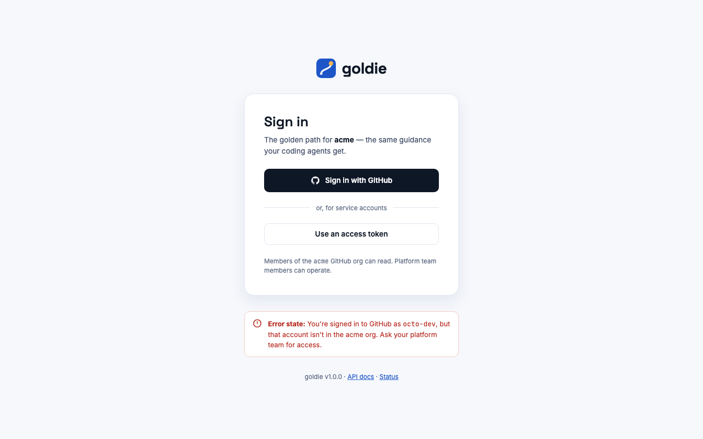
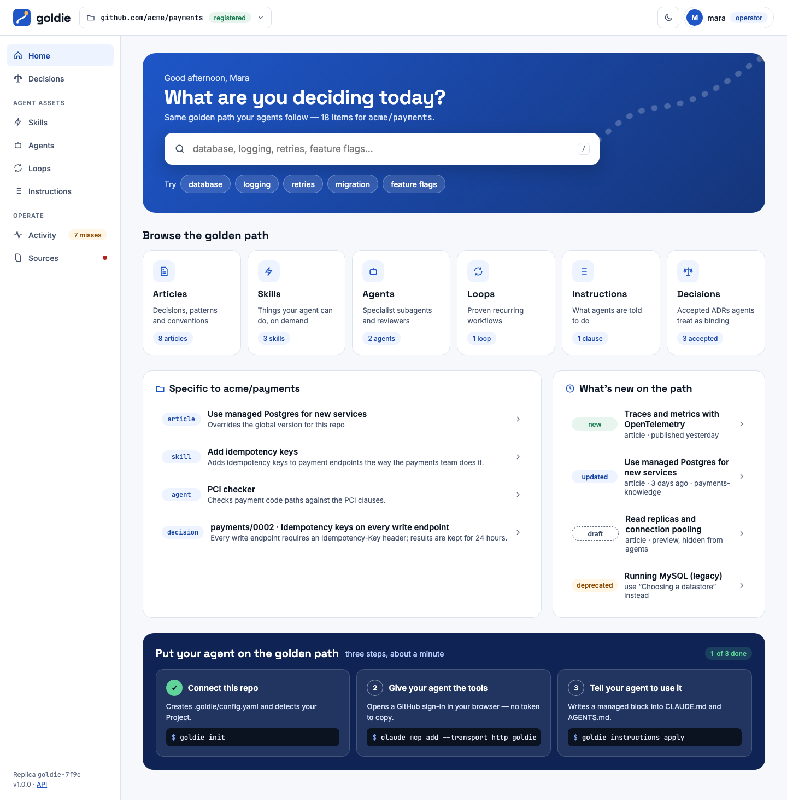
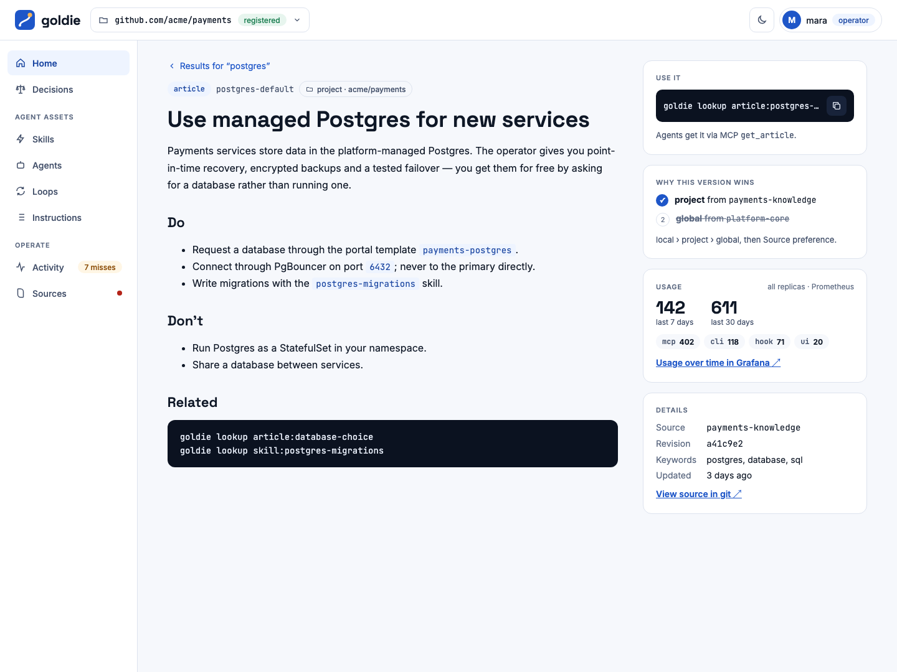
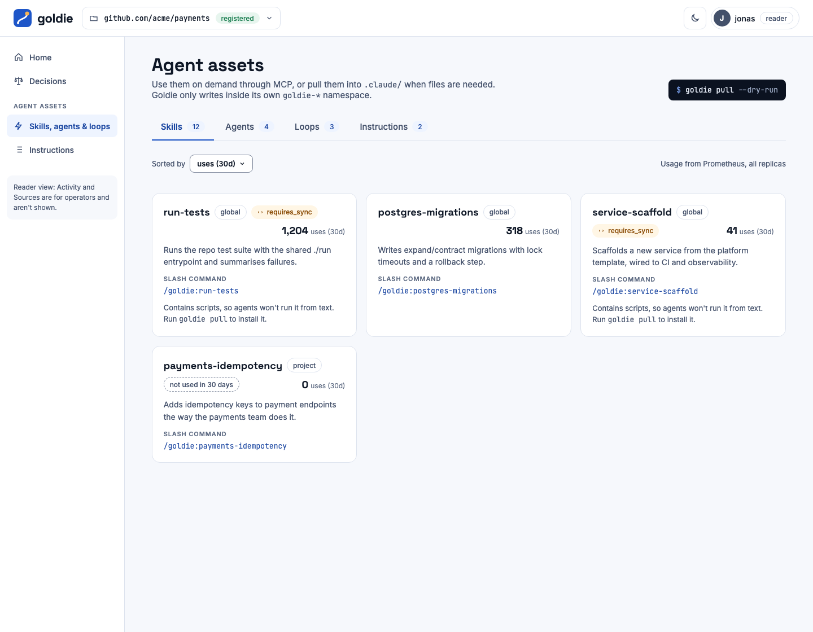
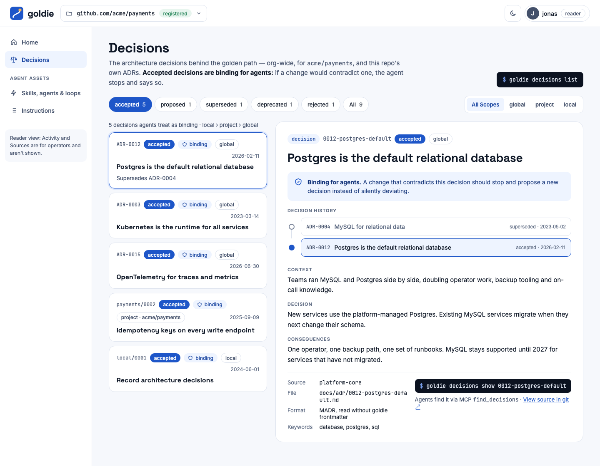
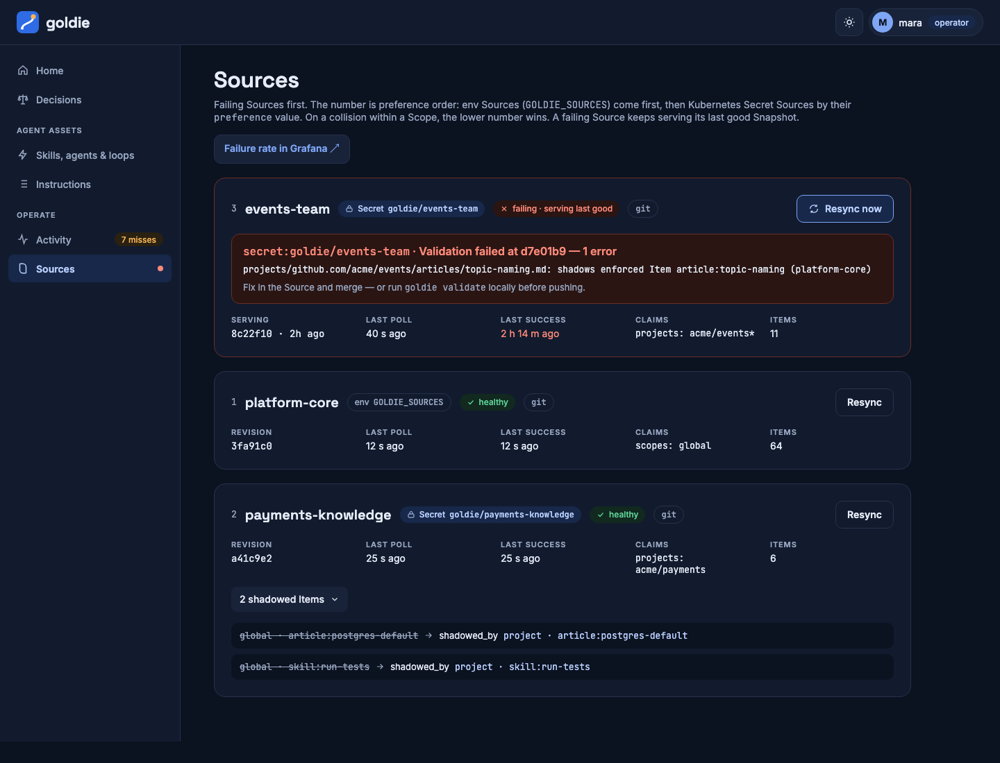
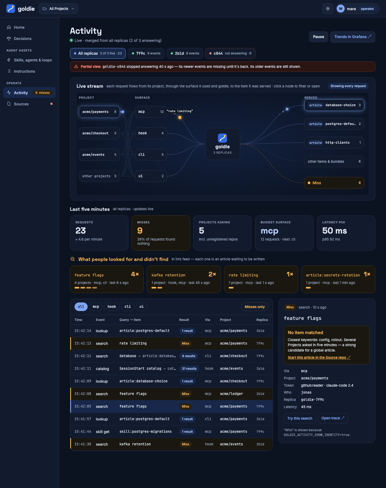
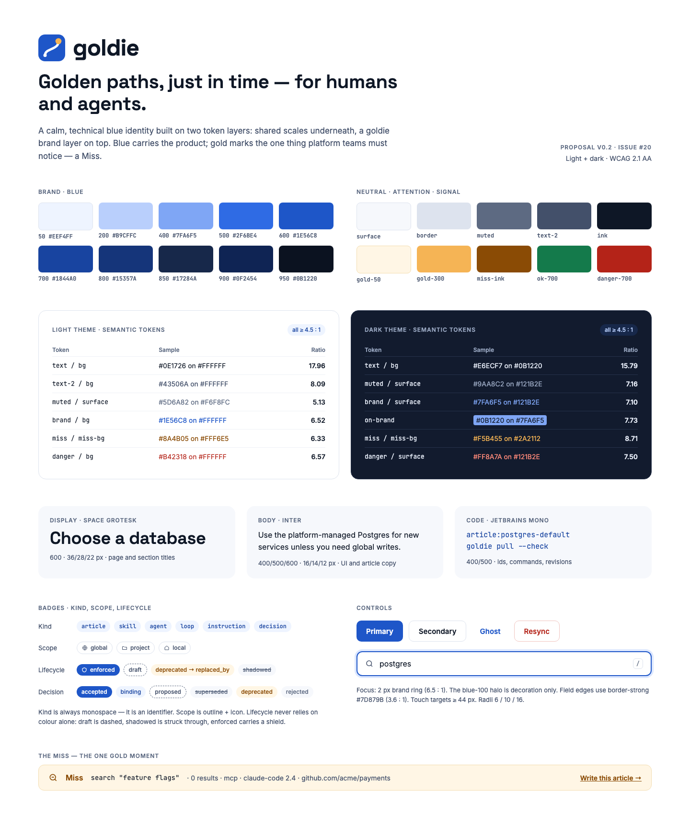

# Goldie UI — design handoff

| | |
|---|---|
| Issue | thschue/goldie#20 (UI design handoff) — unblocks #21, #22, #23 |
| Status | **Approved** 2026-11-22 (#161), v0.2 (2026-11-21): v0.2 completes the token set, adds the missing contrast pairs, and fixes the copy and artboard-count inconsistencies found in implementer review |
| Screenshots | `docs/design/screenshots/` — gallery in §2.4 |
| Prototype | Design canvas "Goldie Design Proposal": https://claude.ai/artifact/2qDw2RVLRTPwKkEwmmEChw (private until shared) |
| Related | #12 + #22 (federated activity), #23 (assets + Decisions page), #31 (Grafana), #32 (usage figures), #33 (Secret-based Sources), #34 (Decisions as a Kind) |
| Aligned with | Issue texts as of 2026-11-21 20:11 UTC — see §14 for the issue-by-issue mapping and open discrepancies |

This document is the contract between design and the UI implementation. The canvas is the throwaway clickable prototype; where the two disagree, **this document wins** and the canvas gets fixed.

---

## 1. Principles

1. **Same golden path as the agents.** The UI shows exactly what Resolution serves to the CLI and MCP. It never computes its own view. Drafts are the only extra, and only for operators.
2. **Now, not over time (Q51).** The UI shows current state and individual events, and lets you act. Trends, rates over time and alerting live in Grafana (#31). The UI shows **no time-series charts or durable aggregates**. Grouping the live in-memory buffer is allowed (e.g. "requests, last 5 min"). The one deliberate overlap is per-Item usage figures (#32): plain numbers, never charts.
3. **A Miss is the one gold moment.** Blue carries the product. Gold is reserved for "someone looked and found nothing", so it never becomes background noise.
4. **Every identifier is copyable and monospace.** Kind, name, project id, revision and command are always shown in JetBrains Mono, and commands always come with a copy button.
5. **Never colour alone.** Every state has a text label or a shape (dashed, struck through, shield) as well as its colour.

---

## 2. Information architecture

### 2.1 Navigation

```
Top bar:  [goldie mark] [Project selector ▾]                 [theme] [account ▾ role]
Side nav: Home
          Articles
          Decisions                       (#34)
          — Agent assets —
          Skills · Agents · Loops · Instructions
          — Operate —                     (operator only)
          Activity  [n misses]
          Sources   [n failing]
```

- The **Project selector** is global. It is detected from the repo when the UI is opened from the CLI (`goldie open`) and is otherwise chosen by the user. It sets the Project for every page and shows `registered` / `unregistered`. The listbox starts with 'All projects (global guidance)', which clears the Project.
- **Operator-only items are absent for readers, not disabled.** Readers see the *Reader nav note* (§8) in the nav instead.
- The footer of the nav shows the serving replica and the version.
- The nav footer also holds **API reference ↗**, a reader link to `/swagger-ui` in a new tab, shown only when the server serves Swagger UI.

### 2.2 Routes (proposal)

| Route | Screen | Role |
|---|---|---|
| `/signin` | Sign in | anonymous |
| `/` | Home (start page) | reader |
| `/?q=…&kind=…` | Search results (same page, results mode) | reader |
| `/items/:kind/:name` | Item detail (article view; asset kinds redirect to their asset page) | reader |
| `/assets/:tab` | Skills / Agents / Loops / Instructions | reader |
| `/decisions?status=&scope=` | Decisions list + selected decision (`&d=<name>`) | reader |
| `/ops/activity` | Activity and Misses | operator |
| `/ops/sources` | Sources and sync status | operator |

The query string carries `project`, `q` and `kind`, so every view is linkable.

### 2.3 Screens on the canvas

| Canvas artboard | Screen | Theme drawn |
|---|---|---|
| `Main` | Identity, tokens, components | light + dark tables |
| `SignIn` | Sign in (GitHub + access token, error) | light |
| `Browse` | Home / search results | light |
| `Article` | Item detail (published / deprecated / draft via tweak) | light |
| `Assets` | Skills, agents, loops, instructions — **reader view** | light |
| `Activity` | Activity and Misses — operator | dark |
| `Sync` | Sources — operator (env and Secret origins) | dark |
| `Decisions` | Decisions (ADRs) — reader view | light |

Every screen ships in **both** themes. The canvas draws each in one theme only to save space.

### 2.4 Screenshots

Rendered from the prototype at 1440 px, each in the theme it was drawn in (see §2.3). Live views are a single moment, so the stream particles and counts are whatever was in flight. These are references, not pixel specs: where a screenshot and the text disagree, the text wins.

| | |
|---|---|
| **Sign in** — GitHub, access token, not-a-member error<br> | **Home** — hero search, Kind tiles, project Items, what's new, setup steps<br> |
| **Item detail** — article, Resolution ladder, usage, details<br> | **Agent assets** — skills sorted by uses (30d), reader view<br> |
| **Decisions** — accepted filter, binding badges, decision history<br> | **Sources** — failing Secret Source first, origins, shadowed Items<br> |
| **Activity** — replica switcher, partial view, live stream, stats, Miss board, feed, detail<br> | **Identity and tokens** — palette, contrast tables, type, badges, controls<br> |

Not captured as screenshots: search results (`/?q=`), the Article lifecycle variants and the usage source variant (canvas tweaks), and the sampling indicator under load (canvas tweak). Open the prototype for these.

---

## 3. Layouts

### 3.1 App shell

- Top bar 64 px. Side nav 240–260 px. Content is fluid, with page padding of 32–40 px (desktop).
- Content max widths: reading column 760 px (article), result list 940 px, ops pages full width.
- **Built so far (#802):** the nav footer holds **API reference ↗**, a plain `<a href="/swagger-ui" target="_blank" rel="noopener">` (not a RouterLink) after the other nav links, for readers and operators. It shows only when the session's `swagger_ui` is true (`GET` and `POST /api/v1/session`); with `GOLDIE_SWAGGER_UI_ENABLED=false`, or an upstream that has it off in UI mode, it is absent. The replica and version line is not built yet, so the link is last. A session cookie opens `/swagger-ui` and `/openapi.json`; writes from "Try it out" need the Authorize button.
- **External links (↗)** are built only from `https:` or `http:` URLs. Links derived from a Source URL ("View source in git", "Start this article in the Source repo", and the skill, agent and bare-name "Add this … to the Source repo" (from #706; until then the link is `/ops/sources` and carries no Source URL)) never carry its credentials: userinfo is stripped, and a link that can't be built that way is hidden. Values inserted into a URL template (the `trace_id` in `GOLDIE_TRACE_URL_TEMPLATE`) are percent-encoded.

### 3.2 Home (`/`, no query)


1. **Hero band** (brand gradient `--brand` → blue‑800): greeting, page question "What are you deciding today?", a 58 px search field, and suggestion chips ("Try: database · logging · retries · migration · feature flags"). `/` focuses the search field from anywhere.
2. **Browse the golden path**: one tile per Kind (icon, name, one-line purpose, count). A tile opens results filtered to that Kind.
3. Two cards side by side: **Specific to `<project>`** (project-scoped Items, overrides first) and **What's new on the path** (new / updated / draft / deprecated, newest first).
4. **Put your agent on the golden path**: a three-step checklist (`goldie init`, `claude mcp add --transport http goldie <url>`, `goldie instructions apply`). Each step has a copy button and can be ticked off. Ticks are stored per browser in `localStorage` and are a convenience only. <!-- keep in step: the commands are the Next block of `goldie init` (internal/cli/init.go, nextBlock) and the README -->

**Built so far (#721):** items 1, 2 and 4. The chips are "database", "logging", "retries" and "feature flags" (no "migration" yet); a chip runs the search. The Browse tiles are Skills, Agents and Loops, each linking to `/assets/<tab>` with the count from its list endpoint; a list that fails leaves its tile without a count. The checklist's second command uses this server's origin plus `/mcp`. The placeholder of §8 "Empty state" no longer shows on Home.

**Built so far (#724):** `/articles?project=` lists the articles of the Project's view (`GET /api/v1/articles`) as cards: name (a link to `/items/article/<id>`), id, Scope badge, a lifecycle badge (`published` when the API sends no status) and one "Overrides `<id>` from `<scope>`" line per shadowed Scope. An empty list says "No articles for `<project>` yet."; a failure shows the standard error.

**Built so far (#725):** the Articles tile joins Skills, Agents and Loops. It shows the count from `GET /api/v1/articles` and opens `/articles`. Every tile keeps the selected Project: its link carries `?project=` and its count is read for that Project. The "Specific to `<project>`" card lists the articles whose Scope is not `global`, overrides first and then by id, each linking to its detail view; the tile and the card share one article request. With no Project it says "Pick a project to see the articles that only apply to it."; with a Project that has none, or that is not registered, it says "Nothing specific to `<project>` yet". A failing article list leaves the tile without a count and the card without a list. "What's new" is not on Home until #726. `/?project=<id>` is Home with that Project selected: the Project's Items list of #496 is gone, and its Items are reached through the tiles and `/articles?project=`.

### 3.3 Search results (`/?q=`)

- The hero stays, with the query in the field and a clear button.
- Kind filter pills (All, article, skill, agent, decision), plus "← Back to home". A pill sets `kind` on the API call and in the URL; there are no counts, since a count per Kind would need another call.
- A result card shows Kind badge · name · Scope badge · lifecycle badges · match explanation, then a score bar, title, summary, and "Overrides `x` from global" when it shadows another Item.
- **Built so far (#731):** Kind badge (mono), name, Scope badge, enforced, draft (dashed card, "draft · hidden from agents") and deprecated badges, the matched line, any "Overrides" lines, a summary only if a hit carries one (the API sends none yet), then an `aria-hidden` score bar with the score as text. "Enforced" is the `--ok-*` role on the card and the article; gold stays for a Miss and a deprecation. A search still loading after 300 ms shows three card skeletons (`aria-busy`); a 429 shows the countdown with Retry disabled.
- Order: score, descending (exact keyword +4, name word +2, keyword substring +1). The `matched` text from the API is shown verbatim.

### 3.4 Item detail (`/items/article/:name`)


- A link above everything goes back to `/`, carrying the Project, Kind and search: "← Back to search" when the Item was opened from a search (`q` set), "← Back to home" otherwise (#754). An article opened from the index (`from=articles`, #812) goes back to `/articles` with the Project: "← Back to articles" (§8).
- Two columns: the article (Markdown, max 760 px), and an aside of at most 360 px.
- The aside contains four cards:
  - **Use it**: the CLI command, with a copy button, and the MCP tool name.
  - **Why this version wins**: the Resolution ladder, with the winner ticked and losers struck through, each with its Source.
  - **Usage** (#32), visible to readers:
    - With `GOLDIE_METRICS_QUERY_URL` set: uses in the last 7 and 30 days, a per-`via` breakdown, and the label "all replicas · Prometheus".
    - Without it: one figure labelled **"since <process start>, this replica"**, never "7 days".
    - "Usage over time in Grafana ↗" appears only with `GOLDIE_GRAFANA_URL` set.
    - No charts.
  - **Details**: Source, revision, keywords, updated, and "View source in git ↗".
- The same Usage card appears on skill, agent and loop detail views.
- The lifecycle banner sits above the title (see §5).
- **Built so far (#732):** the title with a mono Kind badge ("Article") beside it, the id and the Enforced chip, then the article; the aside holds **Use it** (`goldie lookup <id>` with the copy button, and the MCP tool `get_article`) and **Details** (Scope, keywords, and "Overrides `x` from global" only when the article shadows one). Scope shows as a label; its value appears once the Article API carries a `scope` (it shows "—" until then). The aside drops below the article under 1024 px. Loading shows the same layout as a skeleton, with no h1. The Resolution ladder, Usage and the Source, revision and updated lines come with their API.

### 3.5 Agent assets (`/assets/:tab`)


- Header with a `goldie pull --dry-run` snippet, then tabs: Skills · Agents · Loops · Instructions.
- With no Project selected every tab lists the global assets; the note to pick a Project shows only when Projects are registered (§5.2).
- **Skills** (MVP cut, #587): a card grid sorted by name, ascending, with no sort control. Usage figures, the "not used in 30 days" badge and the sort by uses come with #32. Each card shows the name (an h2), Scope (no chip when the API sends none), description and the MCP prompt name `goldie-<name>` (pinned by #411; it replaces the earlier `/goldie:<name>`). Script skills add the `requires_sync` badge and the line "Contains scripts, so agents won't run it from text. Run `goldie pull` to install it."
- **Agents** (MVP cut, #589): a card grid like Skills, sorted by name, ascending. Each card shows the name (an h2), Scope (no chip when the API sends none), description and the materialised path `.claude/agents/goldie-<name>.md` in mono. Usage figures (uses 30d) come with #32.
- **Loops** (MVP cut, #647): a `LoopDetail` article per loop, sorted by name, from `GET /api/v1/loops?project=`; no featured loop and no usage figures. Each shows the name (an h2), Scope (no chip when the API sends none), description, the interval or "dynamic" (the flag wins over a stray interval), the stop condition, the dependency closure as agent and skill chips in a list named "Closure" (no list when the closure is empty), and two `CommandSnippet`s: `goldie pull` and `/loop <interval> /goldie-loop-<name>` (`/loop /goldie-loop-<name>` when dynamic, as `goldie pull` prints it). States are the Skills tab's; the empty copy is "No loops for `<project>` yet."
- **Instructions** (#590): a group of two toggle buttons named `CLAUDE.md` and `AGENTS.md` (`aria-pressed`; `target=claude` / `target=agents`, claude by default or for any other value), kept as `?target=` next to `?project=` and pushed on a click so Back and a reload keep it. Data is `GET /api/v1/instructions?target=&project=`; the UI computes nothing. It shows the full digest in mono, wrapped, with a "Copy digest" button; the managed block (including the decisions clause) rendered with the article renderer, with raw HTML off, invisible and bidirectional controls removed and headings kept contiguous below the page h1; the API's `hint` for an unregistered Project; and a `CommandSnippet` `goldie instructions apply --target <t>`. A newer switch aborts the older load, so a stale answer never lands. States are the Skills tab's; an error reads "Couldn't load instructions." plus the envelope hint.

### 3.6 Activity (`/ops/activity`, operator)


**Built so far (#630, #631, #632, slices 2 to 4 of #22):** the page shows the header line, Pause/Resume, "Misses only", a polite miss-count status and the feed as one `<table>`, read from the merged stream (`GET /api/v1/activity?replicas=all`, through `api()`). The replica switcher is "All replicas" plus one `aria-pressed` button per replica seen, each with its status in words (up or down) and its event count; choosing one filters the rows, and with no peers there is no switcher, and the header reads just "Live". A `replica_status` event for a peer that is down shows the **Partial view.** banner (§8) naming each replica and how long ago it stopped answering; it goes away when the peer is back. A row whose event arrived late carries "LATE" in its Time cell, and rows are keyed by replica and id, so two replicas with the same id both show and select separately. Rows are newest first and the newest 500 are kept; the selected row is kept by replica and event id; a miss reads "Miss · " and then the §8 copy for what was asked for (#576); the Via cell is the surface (see #810 below). A 403 shows "This page is for operators.", a 401 ends the session as everywhere, and a 503 shows its hint. The miss count changes for screen readers at most every 30 s. "Misses only" is a standalone toggle, so it is a checkbox (`role="checkbox"`, `aria-checked`), not a pressed button; a group of toggles, like the replica switcher, uses `aria-pressed`. The **Miss board** (#632) is a region "What people looked for and didn't find" with up to four plain card buttons (no `aria-pressed`: the switcher is the page's pressed set) for the most frequent misses in the feed, grouped by query, each with ×count, number of projects and last seen; a card selects the latest event of its group. Selecting a row or a card opens the **Event detail** region beside (or, when narrow, under) the feed with only the fields the event has (Query, Kind, Project, Token, Replica); a miss adds the §8 copy and the per-kind line ("Add this skill to the Source repo ↗", "Add this agent …", "Start this article …"). The per-kind lines are in the §8 table. The API carries no Source URL, so that link goes to the Sources page (`/ops/sources`) until it does (the target rule and the ↗ note are in the §8 table). "Try this search" opens `/?q=<query>` and is hidden for get events. **Header and tiles (#809):** the header reads "Live" for one replica and "Live · merged from all replicas (n of m answering)" for several, m being the replicas seen and n those heard in the last minute (an event's own time, or a `replica_status` that says up; a replica reported down is not answering, so it is not counted in n). **Last five minutes** is a region of five tiles from per-minute buckets keyed by the event's `time`, not from the 500 rows: Requests (a whole number per minute), Misses (whole percent, "—" with no request), Projects asking (distinct Projects, at most 1000 tallied) and Busiest surface and Latency (#810). A replayed event older than five minutes is not counted; one stamped in the future counts as now. "Trends in Grafana ↗" is not rendered yet. The URL's `project` filters the rows and shows a chip whose button removes it. **Surfaces, Via and Result, latency (#810):** Busiest surface is the surface with the most events of the last five minutes ("—" with none). Latency shows p50 and p95 of `latency_us` over the same window, by nearest rank, in milliseconds with one decimal ("0.9 ms"); an event whose `latency_us` is absent or 0 (a replica older than the field) has no latency and is not counted, and with none the tile shows "—". Above the table a group named "Surface" holds four checkboxes (`role="checkbox"`, `aria-checked`; the replica switcher stays the page's `aria-pressed` set): MCP, CLI, UI and Other, each with its count of events in the whole feed (not the filtered rows). They are multi-select, filter the rows, and combine with the Project chip, the replica switcher and "Misses only". A `via` value the page does not know counts under Other. An event with no `via` shows "—" in the Via cell, counts in no pill and is hidden while a pill is on. The Result cell of a served row is the served Item as sent (`<kind>:<name>`), or "Served" when the event carries no `served`; a miss reads "Miss · No Item matched" (what was asked for is in the detail). The detail adds Query → Item (`<query> → <served>`), Latency, Via and Trace id, each only when the event has it. Event text (served, trace id) is plain text without invisible or bidirectional controls, cut at 200 code points and never inside a character. Still open from items 4 and 6: nearest keywords on a miss, "Open trace ↗" (needs `GOLDIE_TRACE_URL_TEMPLATE`) and Who. The stage comes with a later slice.

From top to bottom:

1. **Header**: a live indicator ("Live" for one replica, "Live · merged from all replicas (2 of 3 answering)"), Pause/Resume, and "Trends in Grafana ↗".
2. **Replica switcher** (#22, federated stream from #12): "All replicas" (default) plus one button per replica with its status dot and event count. A **partial view** banner, driven by `replica_status`, appears while a peer is down. With `GOLDIE_ACTIVITY_PEERS` unset there is one replica: the switcher is gone and the header reads "Live".
3. **Live stream** (380 px stage): four columns, **Project → Surface → goldie → Served**.
   - *Project* shows the three busiest projects plus "other projects".
   - *Surface* shows `mcp`, `hook`, `cli` and `ui`.
   - *Served* shows the three most-served Items plus "other Items & bundles", and Miss.
   - Each request is a particle (blue = found, gold = Miss) labelled with its query on the way in and `→ <kind>:<name>` / `Miss · <project>` on the way out.
   - Nodes glow as a particle passes. An Item node flashes "+1" on arrival.
   - Clicking a project or surface filters the feed, clicking an Item opens it, and clicking Miss toggles "Misses only".
   - **Render budget (Q53):** at most ~30 particles per second. Above that, a status chip reads "Showing 1 in N requests · the feed and Miss board still get every event". Otherwise it reads "Showing every request". Rendering pauses while the tab is hidden (`visibilitychange`).
4. **Last five minutes**: five stat tiles — Requests (≈/min), Misses (% of requests), Projects asking, Busiest surface, Latency p50 (p95 underneath).
5. **Miss board**: up to four cards, Misses grouped by query, each with ×count, number of projects, surfaces, last seen, and fading pips. Clicking a card selects its latest event.
6. **Feed + detail**:
   - The feed has surface pills, a removable project chip, and "Misses only". Columns: Time · Event · Query → Item · Result · Via · Project · Replica.
   - Events that arrive after the reorder window (`late: true`, Q50) are inserted at their timestamp with a small gold **LATE** marker under the time (tooltip: "Arrived after the reorder window").
   - The detail panel shows the result, query, either the served Item or "No Item matched" with nearest keywords and "Start this article in the Source repo ↗", then Via, Project, Token, Who (only with `GOLDIE_ACTIVITY_SHOW_IDENTITY`), Replica and Latency, plus "Try this search" and "Open trace ↗". The panel varies by Kind: for skill and agent gets "Try this search" is hidden (there is no query to run) and nothing replaces it; "Open trace ↗" stays. The trace link is rendered from `GOLDIE_TRACE_URL_TEMPLATE` with the event's `trace_id`, and hidden when the template is unset.

### 3.7 Sources (`/ops/sources`, operator)


- Failing Sources first. The number shown is **preference order** (lower wins on collision): env Sources (`GOLDIE_SOURCES`, shorthands) first, then Kubernetes Secret Sources by `preference`, with ties broken by Secret name (#33).
- A Source card shows the order number, name, an **origin chip** (`env GOLDIE_SOURCES` outline, or a lock icon with `Secret <namespace>/<name>`), status badge (healthy / failing · serving last good / errored), type, and Resync.
- A failing card adds an error alert (identifier, revision, file, rule, and what to do next). Secret Sources are identified as `secret:<namespace>/<name>`.
- A malformed Secret shows as **errored** with the reason (e.g. "missing field `url`"). Secret values never appear.
- When only the built-in `examples` Source is serving (#29), the page shows an info banner (see §5.1).
- Facts grid: revision (or "serving" for a failing Source), last poll, last success, Claims, Items.
- "n shadowed Items" disclosure: `global · kind:name → shadowed_by → project · kind:name`.

### 3.8 Decisions (`/decisions`, #34, #23)


- Header: one line saying what decisions are, "**Accepted decisions are binding for agents:** if a change would contradict one, the agent stops and says so", and a `goldie decisions list` snippet.
- **Status pills** with counts: accepted (default), proposed, superseded, deprecated, rejected, All. The default matches what agents get (accepted only); the others correspond to the API's `status=` filter.
- **Scope switch**: All Scopes · global · project · local.
- Two columns:
  - **List**: a card per decision with number (`ADR-0012`, `payments/0002`, `local/0001`), status badge, a **binding** badge on accepted decisions, Scope, date, title, and one line on supersession ("Supersedes ADR-0004" / "Superseded by ADR-0012").
  - **Selected decision**:
    - Kind badge, identity `decision:<name>`, status, Scope, then the title (struck through when superseded).
    - **Accepted** decisions show a blue "Binding for agents" note. Every other status shows a neutral note explaining why agents don't follow it.
    - **Decision history**: the full supersession chain, oldest to newest, as buttons. Accepted decisions get a filled node, the others an outline node. The current one is highlighted.
    - Context / Decision / Consequences, from the file's sections, rendered with the same Markdown rules as articles (#21: raw HTML disabled, sanitised output).
    - Facts: Source, file path, format ("MADR, read without goldie frontmatter" / "Nygard…" / "goldie frontmatter"), keywords. Plus `goldie decisions show <name>`, the MCP tool `find_decisions`, and "View source in git ↗".
- **Accepted decisions are visually distinct** (#23): solid blue status badge and a binding badge with a shield. Proposed decisions get a dashed card, superseded ones a struck-through muted title, rejected ones a muted title. This follows the lifecycle language in §4.
- Search results (`/?q=`) include `kind=decision`, with an "accepted · binding for agents" badge. The Home page gets a **Decisions** Kind tile.

**Built so far (#736):** the header line and the Status filter (`role=group`, one `aria-pressed` button per lifecycle, accepted by default) over a list of cards with status, a binding badge on accepted decisions, Scope, date, title and one supersession line. A press requests `status=<value>` (All is `status=all`); the URL's `project` rides on every request. Loading skeletons, the empty status and the error alert (the envelope message) follow §5. The `goldie decisions list` snippet in the header, the shield on the binding badge, the decision number on the card (the card shows the title only), counts on the pills and the Scope switch come later.

**Built so far (#737):** `&d=<name>` on `/decisions` selects a decision (a card title is the link; the Project is kept). The page reads `GET /api/v1/decisions/<name>` and shows a panel in a second column beside the list, under it when narrow: title, status, Scope and date; the §8 lifecycle note (the binding note for accepted decisions, the neutral note for every other status, plain text and never a live region); the Markdown body through the article renderer; the keywords; and the history. The history is the API's `chain`, oldest to newest, as an ordered list of links by decision, with the current entry marked `aria-current="step"`; it is hidden when the chain has one entry. A superseded decision's note links to its successor. A filter change announces the result count in one polite status. An unknown name shows the API's message and hint in an alert. Deferred, because the API does not serve the data or the item goes beyond the criteria of #737: the Kind badge and the `decision:<name>` identity line (no criterion asks for them), Source, file path and format (the API serves none of them), the CLI, MCP and "View source in git" lines (they depend on the same missing Source data), and the filled and outline history nodes (the history is a plain list for now).

---

## 4. Components

| Component | Variants / props | Notes |
|---|---|---|
| `AppShell` | role: reader \| operator | Top bar + side nav. The nav collapses below 1024 px (see §7). |
| `ProjectSelector` | registered \| unregistered \| detected | Shows the full `host/org/repo` id in mono. The first option clears the Project (#804). |
| `ThemeToggle` | light \| dark \| system | Persists the choice. `system` follows `prefers-color-scheme`. |
| `SearchField` | hero \| compact | `/` shortcut hint, clear button, `type="search"`, labelled. Submitted in JavaScript (see the `Forms` row). |
| `SuggestionChip` | on-hero \| on-surface | A button. Sets the query. |
| `KindTile` | per Kind | Icon, name, purpose, count. A button. |
| `ResultCard` | default · enforced · draft · deprecated · shadowing | The whole card is one link. Score bar is `aria-hidden`; the score text stays readable. |
| `KindBadge` | article · decision · skill · agent · loop · instruction | Mono, blue‑50 / blue‑700. |
| `ScopeBadge` | global · project · local | Outline + icon. |
| `LifecycleBadge` | enforced · draft · deprecated · shadowed · not-used-30d | Shield / dashed / gold / struck through / dashed neutral. |
| `DecisionStatusBadge` | accepted · proposed · superseded · deprecated · rejected (+ `binding`) | Solid blue / dashed / struck through / gold / muted. The binding badge has a shield. |
| `DecisionCard`, `DecisionHistory` | selected · not | The history is an `<ol>` of buttons; the current item is marked with `aria-current="step"`. |
| `UsageFigures` | prometheus \| process | 7d + 30d + per-`via` chips, or a single "since <start>, this replica" figure. Never a chart. |
| `OriginChip` | env \| secret | Lock icon for Secret Sources. |
| `SamplingIndicator` | every \| 1-in-N | `role="status"`, updated at most once a second. |
| `ResolutionLadder` | n steps | Winner ✓, losers struck through, Source names. |
| `CommandSnippet` | inline \| block | Code surface + copy button (`aria-label="Copy command"`). |
| `SetupChecklist` | 3 steps | Toggle buttons with `aria-pressed`. |
| `AssetTabs` | Skills · Agents · Loops · Instructions | WAI-ARIA tabs with roving tabindex (see §9, finding A3). |
| `SkillCard`, `AgentRow`, `LoopDetail`, `InstructionPreview` | — | See §3.5. |
| `ReplicaSwitcher` | all \| one; up \| down | Toggle-button group. Status also in text. |
| `LiveStream` | — | `role="img"` with a live text summary. Particles off under reduced motion. |
| `StatTile` | default \| attention (gold) | Label, value, sub-line. |
| `MissCard` | — | A button. Selects the latest matching event. |
| `EventRow` | found · miss · selected · fresh | See finding A4 on table semantics. |
| `EventDetail` | hit \| miss | — |
| `SourceCard` | healthy · failing · syncing | Resync is CSRF-protected and operator only. |
| `Alert` | info · warning (gold) · danger | `role="alert"` only for new errors; otherwise `role="status"`. |
| `Forms` | sign-in token form · `SearchField` | The SPA runs under `form-action 'none'` (the UI bullet under "Settings and endpoints" in `docs/platform-contract.md`). A native submit is blocked silently, so Enter would do nothing. Put `@submit.prevent` on the `<form>` so Enter still submits, then use `fetch` and the router. GitHub sign-in is a link or `location` navigation to the server's GitHub OAuth start endpoint (owned by #25), never a form post; leaving the origin by navigation is not blocked by `form-action`. |

---

## 5. States

Legend: **C** = drawn on the canvas, **D** = specified here only (to be added to the canvas before build, or built straight from this spec).

### 5.1 Global

| State | Behaviour | Copy | |
|---|---|---|---|
| Unauthenticated | Any route redirects to `/signin?next=<route>` and returns there after sign-in. `next` is honoured only as a same-origin path (a single leading `/`, no scheme, host, `//` or `\`); anything else falls back to `/`. Check the value once it is decoded, wherever the redirect is issued (the client router and the OAuth callback alike): reject control characters and whitespace, and a second character of `/` or `\`; then resolve it against goldie's own origin, require the same origin, and redirect only to the resolved path, query and fragment. `next` travels with the OAuth `state` (#25), never inside GitHub's `redirect_uri`. | — | D |
| Session expired | Non-blocking banner on the next API 401; the current view stays visible. | "Your session ended. **Sign in again** to keep going." | D |
| Session check failed | The first session check got a 429, a 5xx or no answer: the URL and the sign-in are kept, the page waits behind a danger alert (an h1, text, Retry; Retry takes focus when the alert appears and again after each repeat failure; a repeat failure replaces the alert so it is announced again). Only a 401 signs the person out. | Copy in §8. | D |
| Not a member | The sign-in page shows a danger alert. | "You're signed in to GitHub as `<login>`, but that account isn't in the `<org>` org. Ask your platform team for access." | C |
| GitHub not configured | Only the access-token form is shown, with no divider. | — | D |
| Loading (first paint) | Skeletons that match the final layout (cards, rows, tiles) at blue‑50 / surface‑3. No spinners for under 300 ms. | — | D |
| API error | An inline `Alert` (danger) in the failed region, built from the error envelope: `message` plus the first `details` hint. A Retry button where the call is safe to retry. Never stack traces or addresses. | "Couldn't load search results. `<hint>` **Retry**" | D |
| Client too old | Banner when the server sends a min-version error. | "This page is out of date. Reload to get the latest goldie UI." | D |
| API unreachable (#24) | In mode `ui`, when the upstream API is down: full-page state with a retry. Cached content is not shown as if live. Shown for a failed fetch or the proxy's 502 `upstream_unavailable` envelope only, never with its text; any other error keeps its own alert. Retry now mounts the view again. | "**API unreachable.** goldie's API isn't answering right now. We'll keep trying. **Retry now**" | D |
| Rate limited (#11) | `429` with `Retry-After`: inline warning in the affected region; the retry button stays disabled for the countdown. | "Too many requests — try again in `<n>` s." | D |
| Examples only (#29) | When no Source is configured and the built-in `examples` Source is serving: an info banner on Home and Sources (dismissible per session on Home, permanent on Sources). | "You're looking at **example content**. Configure a Source to serve your own golden path. **How to add a Source**" | D |
| Offline / SSE dropped | Live indicator turns grey; reconnects with backoff. | "Reconnecting…" | D |

### 5.2 Content states

| State | Where | Treatment | |
|---|---|---|---|
| Empty search (Miss) | Results | Gold dashed panel, no-match copy (§8), suggestion chips. | C |
| Empty Kind | Results with a Kind filter | Neutral panel: "No `<kind>`s for `<project>` yet."; without a Project: "No `<kind>`s yet." | D |
| Asset tab, no Project selected (#758) | Skills, Agents, Loops, Instructions | Lists the global assets (the request leaves `project` out); empty copy "No `<noun>` yet." With Projects registered it adds the note "Pick a Project from the selector to see its `<noun>`."; with none, no note. | D |
| Project selector, all projects option (#804) | Project selector | First option "All projects (global guidance)", always present: while the list loads, after a failed load and with no Projects registered (the note sits below it). Choosing it pushes the URL without `project` and keeps `q` and `target`, so Back restores the Project. `aria-selected` is true only when no Project is set; it has no `registered` / `unregistered` chip. Opening lands on the current Project, or on this option when there is none. | D |
| Unregistered Project | Project selector + Home | `unregistered` chip; Home shows a hint: "Global and local guidance only. **How to register this project**". | D |
| Draft | Card, detail | Dashed outline + "draft · hidden from agents"; detail banner (dashed). Operators only; readers never see drafts. | C |
| Deprecated | Card, detail | Gold badge "deprecated → `replaced_by`"; detail banner with a link to the replacement. | C |
| Shadowed | Card, detail, Sources | "Overrides `x` from global"; ladder in detail; `shadowed_by` list on Sources. | C |
| Enforced | Card, detail | Shield badge. Suppression controls never offered. | C |
| Suppressed | Home / detail | Not listed. On direct link: info alert "Suppressed for `<project>` in project.yaml." | D |
| `requires_sync` | Skill card | Badge + pull instruction. | C |
| No activity yet | Activity | Stage shows idle nodes; feed: "No requests yet. Run `goldie search` or ask your agent something." | D |
| Filter has no rows | Activity feed | "Nothing matches these filters in the last five minutes." | C |
| Replica down | Activity | Partial-view banner, red status dot + "not answering". | C |
| Source failing | Sources, nav | Failing card first, error alert, red dot in nav. | C |
| Source syncing | Sources | Resync button → "Syncing…" (disabled) → back. | C |
| Source never loaded | Sources | Danger card: "Not loaded yet — goldie isn't ready until this Source loads once." Only Sources present at startup gate readiness. | D |
| Runtime Secret Source failing (#33) | Sources | Errored card; copy says it does **not** affect readiness: "Added at runtime — errors here don't make goldie unready." | D |
| Malformed Secret (#33) | Sources | Errored card `secret:<ns>/<name>` with the field-level reason; never values. | D |
| Late event (Q50) | Activity feed | LATE marker under the time. | C |
| Sampling (Q53) | Activity stream | "Showing 1 in N requests" chip (heavyLoad tweak on the canvas). | C |
| Usage, process counters (#32) | Item detail, asset lists | "since <process start>, this replica" label (usageData tweak on the canvas). | C |
| Not used in 30 days (#32) | Asset lists, detail | Dashed neutral badge. | C |
| Decisions: none for filter | Decisions list | "No decisions with this status and Scope. Proposed and rejected decisions are only shown when you ask for them — agents never see them." | C |
| Decision not accepted | Decision detail | Neutral note per status (superseded → "Agents follow `<newer>` instead", proposed, rejected, deprecated). | C |
| Decision file unparseable (#34) | Sources | Shown as a validation error on its Source card, naming the file. | D |

### 5.3 Reader vs operator

| Element | Reader | Operator |
|---|---|---|
| Activity, Sources nav + routes | hidden (route returns 403 page: "This page is for operators.") | shown |
| Drafts | never shown | shown, dashed, with "Show drafts" toggle (off by default) |
| Decisions, all statuses | shown via status pills | shown |
| Usage figures (#32) | shown (no identity) | shown |
| Resync | — | shown |
| "Who" in Activity | — | only with `GOLDIE_ACTIVITY_SHOW_IDENTITY=true` |
| Account chip | `reader` (outline) | `operator` (blue fill) |

The account chip shows a decorative caret (hidden from assistive technology) after the role, so it reads as a button that opens a menu.

---

## 6. Tokens


### 6.1 Structure

Goldie's tokens use two layers:

```
tokens.css          shared scales + semantic role layer + dark theme + reduced motion   (shared, unchanged)  
goldie.css          @import './tokens.css'; brand layer only                             (new, this handoff)
```

- **Shared and used unchanged:** spacing `--space-*`, type scale `--text-*`, radii `--radius-*`, shadows, transitions, and the reduced-motion rule.
- **Role names used by every component:** `--surface-1..3`, `--fg-default`, `--fg-muted`, `--border-default`, `--border-strong`, `--brand`, `--brand-hover`, `--focus-ring`, `--code-surface`.

> **Deviation to approve:** in a two-layer token system, brands usually differ only in their gradient. Goldie is a product with "its own identity" (#1, #20), so `goldie.css` also overrides the brand colour and the role layer. The scales stay shared.

### 6.2 Brand layer (`goldie.css`)

```css
@import './tokens.css';

@theme {
  --color-brand-primary: #1e56c8;      /* blue-600 */
  --color-brand-primary-dark: #1844a0; /* blue-700 */
  --color-brand-accent: #f5b455;       /* gold-300 — Miss only */
  --color-gradient-start: #1e56c8;
  --color-gradient-end: #15357a;
}

@layer base {
  :root {
    --color-brand-primary-on-dark: #7fa6f5; /* blue-400 */
    --surface-1: #ffffff;  --surface-2: #f6f8fc;  --surface-3: #eef1f6;
    --fg-default: #0e1726; --fg-secondary: #43506a; --fg-muted: #5d6a82;
    --border-default: #dde3ee;            /* decorative: card edges, dividers */
    --border-subtle: #eef1f6;             /* decorative: table and list row dividers */
    --border-strong: #7d879b;             /* form fields and control edges, 3.6:1 */
    --brand: #1e56c8; --brand-hover: #1844a0; --brand-tint: #eef4ff; --brand-tint-ink: #1844a0;
    --brand-tint-strong: #dce7fe;         /* blue-100: selected-card ring, search halo (decorative) */
    --brand-edge-active: #5b7fc4;         /* node / control edge while active, 3.98:1 */
    --on-brand-muted: #dce7fe;            /* secondary text on the brand gradient, 5.25:1 at worst */
    --focus-ring: #1e56c8;                /* overrides shared orange, see 6.4 */
    --miss-bg: #fff6e5;                   /* Miss chips */
    --miss-surface: #fff6e5;              /* Miss panels, Miss rows, Miss board cards */
    --miss-pressed: #fce7c2;              /* pressed Miss toggle / node */
    --miss-border: #f3ddb0; --miss-ink: #8a4b05; --miss-solid: #f5b455;
    --miss-solid-ink: #0b1220;            /* text on --miss-solid, 10.29 */
    --miss-line: #e9c88a;                 /* decorative: dashed Miss path in the stream */
    --ok-ink: #147a4b; --ok-bg: #e7f5ee;
    --danger-ink: #b42318; --danger-bg: #fef3f2; --danger-border: #f1c4bf;
    --stream-stage: #f4f7fe;              /* centre of the stream stage; edges fade to --surface-1 */
    --stream-line: #c9d6ee;               /* decorative: surface → goldie → Item paths */
    --stream-line-faint: #e3e9f4;         /* decorative: project → surface fan */
    --row-flash: #e8effe;                 /* start colour of the new-row flash; muted text 4.73:1 */
    --code-surface: #0b1220;
  }
}

[data-theme='dark'] {   /* and the same block under prefers-color-scheme: dark, as in tokens.css */
  --surface-1: #0b1220;  --surface-2: #121b2e;  --surface-3: #18233a;
  --fg-default: #e6ecf7; --fg-secondary: #b8c3d9; --fg-muted: #9aa8c2;
  --border-default: #26324b;            /* decorative */
  --border-subtle: #1c2740;             /* decorative: row dividers */
  --border-strong: #5a6782;             /* fields, 3.0:1 on surface-2 */
  --brand: #7fa6f5; --brand-hover: #b9cffc; --brand-tint: #17284a; --brand-tint-ink: #b9cffc;
  --brand-tint-strong: #1c3366;
  --brand-edge-active: #4a6aa8;         /* 3.21:1 on surface-2 */
  --on-brand-muted: #dce7fe;
  --focus-ring: #7fa6f5;
  --miss-bg: #2a2112; --miss-surface: #1a1710; --miss-pressed: #3a2d14;
  --miss-border: #4a3a1c; --miss-ink: #f5b455; --miss-solid: #f5b455;
  --miss-line: #5a4520;                   /* --miss-solid-ink (#0b1220) is the same in dark: inherited */
  --ok-ink: #5fd39a; --ok-bg: #11291f;
  --danger-ink: #ff8a7a; --danger-bg: #2a1513; --danger-border: #6b2e28;
  --stream-stage: #13213f;
  --stream-line: #2a3a5c;
  --stream-line-faint: #1f2b44;
  --row-flash: #1c3366;                 /* muted text 5.11:1 */
}
```

**Secondary vs muted:** in both themes `--fg-secondary` (supporting copy such as summaries and descriptions) is one step stronger than `--fg-muted` (labels, metadata, timestamps, placeholders). In dark mode they used to be the same colour; v0.2 separates them (`#B8C3D9` / `#9AA8C2`).

**Rule for the build:** components use only role tokens. A hex value in a component is a review finding. The canvas has been brought in line: every colour it uses maps to a token above.

Blue ramp: 50 `#EEF4FF` · 100 `#DCE7FE` · 200 `#B9CFFC` · 400 `#7FA6F5` · 500 `#2F6BE4` · 600 `#1E56C8` · 700 `#1844A0` · 800 `#15357A` · 850 `#17284A` · 900 `#0F2454` · 950 `#0B1220`.

### 6.3 Contrast ratios (WCAG 2.1 relative luminance, computed)

**Light**

| Pair | Ratio | Use | Passes |
|---|---|---|---|
| `#0E1726` on `#FFFFFF` | 17.96 | body text | AA, AAA |
| `#43506A` on `#FFFFFF` | 8.09 | secondary text | AA, AAA |
| `#43506A` on `#F6F8FC` | 7.61 | secondary on surface‑2 | AA, AAA |
| `#5D6A82` on `#FFFFFF` | 5.46 | muted, labels, placeholder | AA |
| `#5D6A82` on `#F6F8FC` | 5.13 | muted on surface‑2 | AA |
| `#5D6A82` on `#EEF1F6` | 4.82 | muted on surface‑3 (skeleton text, tab background) | AA |
| `#43506A` on `#EEF1F6` | 7.15 | secondary on surface‑3 | AA, AAA |
| `#43506A` on `#FFF6E5` | 7.54 | secondary on miss‑surface | AA, AAA |
| `#8A4B05` on `#FCE7C2` | 5.62 | miss‑ink on miss‑pressed | AA |
| `#B42318` on `#FEF3F2` | 6.05 | danger‑ink on danger‑bg | AA |
| `#0E1726` on `#FEF3F2` | 16.52 | text on danger‑bg | AA, AAA |
| `#5D6A82` on `#E8EFFE` | 4.73 | muted on row‑flash (peak of the flash) | AA |
| `#1E56C8` on `#FFFFFF` | 6.52 | links, brand text, focus ring | AA |
| `#FFFFFF` on `#1E56C8` | 6.52 | primary button | AA |
| `#1844A0` on `#EEF4FF` | 8.01 | Kind badge | AA, AAA |
| `#1E56C8` on `#EEF4FF` | 5.91 | active nav | AA |
| `#8A4B05` on `#FFF6E5` | 6.33 | Miss text | AA |
| `#147A4B` on `#E7F5EE` | 4.77 | `registered` chip (12 px) | AA |
| `#B42318` on `#FFFFFF` | 6.57 | danger text | AA |
| `#DCE7FE` on `#1E56C8` | 5.25 | hero sub-text (worst point of gradient) | AA |
| `#FFFFFF` on ≈`#3768CE` | 5.21 | hero suggestion chips (12 % white over blue) | AA |
| `#7D879B` on `#FFFFFF` | 3.61 | field border (non-text) | 1.4.11 |
| `#5B7FC4` on `#FFFFFF` | 3.98 | brand‑edge‑active (non-text) | 1.4.11 |
| `#5B7FC4` on `#F6F8FC` | 3.74 | brand‑edge‑active on surface‑2 (non-text) | 1.4.11 |

**Dark**

| Pair | Ratio | Use | Passes |
|---|---|---|---|
| `#E6ECF7` on `#0B1220` | 15.79 | body text | AA, AAA |
| `#E6ECF7` on `#121B2E` | 14.49 | text on panels | AA, AAA |
| `#9AA8C2` on `#121B2E` | 7.16 | muted | AA, AAA |
| `#9AA8C2` on `#0B1220` | 7.80 | muted on page | AA, AAA |
| `#9AA8C2` on `#18233A` | 6.53 | muted on surface‑3 | AA |
| `#B8C3D9` on `#0B1220` | 10.56 | secondary on surface‑1 | AA, AAA |
| `#B8C3D9` on `#121B2E` | 9.69 | secondary on surface‑2 | AA, AAA |
| `#B8C3D9` on `#18233A` | 8.84 | secondary on surface‑3 | AA, AAA |
| `#E6ECF7` on `#1A1710` | 15.08 | text on miss‑surface | AA, AAA |
| `#9AA8C2` on `#1A1710` | 7.46 | muted on miss‑surface | AA, AAA |
| `#F5B455` on `#3A2D14` | 7.37 | miss‑ink on miss‑pressed | AA, AAA |
| `#E6ECF7` on `#2A1513` | 14.57 | text on danger‑bg | AA, AAA |
| `#9AA8C2` on `#1C3366` | 5.11 | muted on row‑flash (peak of the flash) | AA |
| `#7FA6F5` on `#121B2E` | 7.10 | links, brand | AA, AAA |
| `#0B1220` on `#7FA6F5` | 7.73 | pressed pill | AA, AAA |
| `#B9CFFC` on `#17284A` | 9.31 | badges | AA, AAA |
| `#F5B455` on `#2A2112` | 8.71 | Miss chip | AA, AAA |
| `#F5B455` on `#1A1710` | 9.83 | Miss panels | AA, AAA |
| `#0B1220` on `#F5B455` | 10.29 | "Misses only" pressed | AA, AAA |
| `#FF8A7A` on `#2A1513` | 7.55 | danger alert | AA, AAA |
| `#5FD39A` on `#11291F` | 8.28 | healthy badge | AA, AAA |
| `#5A6782` on `#121B2E` | 3.03 | field border (non-text) | 1.4.11 |
| `#4A6AA8` on `#121B2E` | 3.21 | brand‑edge‑active (non-text) | 1.4.11 |

**Decorative tokens** carry no information on their own, so they have no ratio requirement: `--border-default`, `--border-subtle`, `--brand-tint-strong`, `--stream-stage`, `--stream-line`, `--stream-line-faint`, `--miss-line`. For example, `#DDE3EE` is 1.29 : 1 on white and `#26324B` is 1.34 : 1 on `#121B2E`. They must never be the only boundary of an input or the only sign of a state.

### 6.4 Focus

The shared layer's default `--focus-ring` is orange. In goldie it sits too close to the gold Miss colour, and a focused Miss card would read as "attention" twice. **Proposal:** override it with `--brand` (6.52 light, 7.10 dark). Focus style: a 2 px outline in `--focus-ring` with a 2 px offset, `:focus-visible` only. The soft blue halo on the search field is decorative (1.24 : 1) and is never the only indicator.

### 6.5 Type

Space Grotesk 600 for display (36 / 28 / 22 / 18), Inter 400/500/600 for UI and body (16 / 15 / 14 / 13 / 12), JetBrains Mono 400/500 for ids and commands. Body line-height is 1.55–1.7; minimum text size is 12 px (badges only).

### 6.6 Motion

Durations come from the shared `--transition-*` tokens. Live-stream particles take 3.6 s per request; the UI updates at about 20 fps. Under `prefers-reduced-motion: reduce`: no particles or labels, no row flash, no ping. Node highlights still change state, but without transition.

---

## 7. Responsive breakpoints

| Range | Shell | Notable changes |
|---|---|---|
| ≥ 1280 px | Side nav 240–260 px + content | As drawn. |
| 1024–1279 px | Side nav 220 px | Article aside wraps under the article at < 1100 px. Activity detail panel wraps under the feed. |
| 768–1023 px | Nav collapses to a **menu button** in the top bar (drawer, focus-trapped, Esc closes) | Kind tiles 2–3 per row. Stream keeps all four columns at 340 px height. |
| < 768 px | Top bar: mark, Project (short `org/repo`), menu | Hero search 52 px; suggestion chips scroll horizontally. Stream drops the **Project** column (Surface → goldie → Served). Feed scrolls horizontally inside its panel (min 800 px). Stat tiles 2 per row. Sources facts 2 per row. |

There is no horizontal page scroll at any width, and touch targets are ≥ 44 px. The canvas draws only the desktop layout. Narrow layouts are built from this table and checked in Playwright at 375, 768 and 1280.

---

## 8. Copy

**This table is the single source for wording.** Elsewhere the document refers to a key (e.g. *Reader nav note*) rather than repeating the text. Where quoted text appears elsewhere as an example, this table wins.

**Voice:** short, direct, and helpful. Say what happened and what to do next. Never blame the user. Use "goldie" in lower case and "Miss", "Item", "Source", "Project" with capitals, as in CONTEXT.md.

| Key | Copy |
|---|---|
| Home question | What are you deciding today? |
| Project selector, no Project | Choose a Project (trigger text with no Project). The first option reads All projects (global guidance). |
| Home sub-line | Same golden path your agents follow — `<n>` Items for `<project>`. |
| Rate limited, countdown over | Too many requests — you can retry now. |
| Search placeholder | database, logging, retries, feature flags… |
| No results | **No golden path for “`<q>`” yet.** Try other words — Items are found by their keywords. This search was recorded as a **Miss**, so the platform team knows guidance is wanted here. |
| Draft banner | **Draft preview.** Agents and API consumers can't see this yet. Merge with `status: published` to release it. |
| Deprecated banner | **Deprecated.** Still served to agents with a warning. Use `<replaced_by>` instead. |
| Shadowing line | Overrides `<kind:name>` from global |
| requires_sync | Contains scripts, so agents won't run it from text. Run `goldie pull` to install it. |
| Back to articles | ← Back to articles (an article opened from the index, `from=articles`; back to `/articles` with the Project. From a search it stays "← Back to search", otherwise "← Back to home".) |
| Articles global note | Global guidance. Choose a Project to include its articles. (A note after the `/articles` `h1` when no Project is selected; absent with one.) |
| API reference link | API reference ↗ (accessible name: API reference (opens in a new tab); the ↗ is `aria-hidden`; absent, not disabled, when the server does not serve Swagger UI) |
| Reader nav note | Reader view: Activity and Sources are for operators and aren't shown. |
| Empty state | Nothing to show yet. Content appears here as goldie's pages come online. (A neutral `role="status"` panel under the page's `h1`, on every §2.2 route whose screen isn't built yet; Home's `h1` is the *Home question*.) |
| Not found | **Page not found** — There's no page at this address. Check the link, or start again from Home. — link: Go to Home (to `/`). The `h1` is the first line; no other chrome changes. |
| Operators only | This page is for operators. (The 403 page a reader gets on Activity and Sources, §5.3.) |
| Sign-in lead | The golden path for **`<org>`** — the same guidance your coding agents get. |
| Token help | Exchanged once for a secure session. The token is never stored in your browser. |
| Wrong token | That token wasn't accepted. Check it and try again, or ask your platform team for a new one. (A danger `Alert` with `role="alert"`, followed by the error envelope's `details.hint`, tied to the token field with `aria-describedby`.) |
| Sign-in failed | Couldn't sign in. Try again in a moment. (Any other failure of the sign-in call, same `Alert`.) |
| Sign out | Sign out (the one item in the role chip's menu; returns to `/signin`) |
| Sign out failed | Could not sign you out. You are still signed in. **Retry** (a `role="alert"` above the page; the user stays on the page and signed in until the DELETE succeeds.) |
| Session check failed | **Could not check your session** (the page's h1), then "Your sign-in is not affected." and **Retry** (a `role="alert"` in place of the page, no role chip; shown when the first `GET /api/v1/session` answers 429, 5xx or not at all. Only a 401 leads to `/signin?next=`. Retry asks again.) |
| First load | Loading… (a `main` landmark holding a `role="status"` region with an `h1` (so the page always has one main and one h1; the shell, with its own `main`, replaces it) shown by the app until the first session check settles; no shell, view or chip yet.) |
| Activity live | Live · merged from all replicas (`<up>` of `<n>` answering) |
| Partial view | **Partial view.** `<replica>` stopped answering `<t>` ago — its newer events are missing until it's back. |
| Miss board heading | What people looked for and didn't find |
| Miss detail | No Item matched · `<nearest keywords>` · Start this article in the Source repo ↗ |
| Skill or agent get, Query → Item | `skill:<name>` or `agent:<name>` |
| Skill or agent miss, result | No skill named `<name>` / No agent named `<name>` |
| Article miss, result (Activity feed) | No article named `<name>` |
| Search miss, result (Activity feed) | No results for `<query>` |
| Bare-name get miss, result (a replica older than the Reference form) | No skill or agent named `<name>` |
| Skill miss, detail | Add this skill to the Source repo ↗ |
| Agent miss, detail | Add this agent to the Source repo ↗ |
| Bare-name get miss, detail | Add this skill or agent to the Source repo ↗ |
| Article miss, detail (lookup) | Start this article in the Source repo ↗ |
| Target of the four "Source repo ↗" lines above | One link, the same for skill, agent, bare-name and article misses: the web address of the Source the Scope maps to (#706), hidden when no Source applies. Today the API carries no Source URL, so it goes to `/ops/sources`, and the ↗ stays on the label (locked by `missBoard.test.ts`) although the target is internal; the glyph is exact once #706 lands. |
| Source failing | Validation failed at `<rev>` — `<n>` error(s). Fix in the Source and merge — or run `goldie validate` locally before pushing. |
| Sources intro | Failing Sources first. The number is preference order: on a collision within a Scope, the lower number wins. A failing Source keeps serving its last good Snapshot. |
| Grafana links | Trends in Grafana ↗ · Usage over time in Grafana ↗ (hidden without `GOLDIE_GRAFANA_URL`) |
| Trace link | Open trace ↗ (hidden without `GOLDIE_TRACE_URL_TEMPLATE`) |
| Sampling | Showing every request · Showing 1 in `<n>` requests · the feed and Miss board still get every event |
| Usage source | all replicas · Prometheus · since `<time>`, this replica |
| Unused badge | not used in 30 days |
| Decisions intro | The architecture decisions behind the golden path — org-wide, for `<project>`, and this repo's own ADRs. **Accepted decisions are binding for agents:** if a change would contradict one, the agent stops and says so. |
| Binding note | **Binding for agents.** A change that contradicts this decision should stop and propose a new decision instead of silently deviating. |
| Superseded note | Superseded — kept for history. Agents follow `<newer>` instead. |
| Proposed note | Proposed — under review. Agents and default API queries don't see it until it is accepted. |
| Rejected note | Rejected — kept so the question isn't reopened without new facts. Not served to agents. |
| Deprecated note | Deprecated — kept for history. Agents don't follow it. |
| Secret origin | Secret `<namespace>/<name>` · env `GOLDIE_SOURCES` |

Greeting: "Good morning / afternoon / evening, `<first name>`", taken from the GitHub profile name. Fall back to the login, or omit it for token sessions. No emoji anywhere in the UI.

---

## 9. WCAG 2.1 AA review

**Scope:** a design review of the canvas prototype (all eight artboards listed in §2.3) against WCAG 2.1 AA, on 2026-11-21. It is not an audit of built code. The build must re-check with axe in Playwright plus a manual keyboard and screen-reader pass (VoiceOver + NVDA) for the flows in #21–#23.

### 9.1 Passes by design

- **1.4.3 Contrast (minimum):** every text pair in §6.3 is ≥ 4.5 : 1. The lowest is 4.73 (muted text on the peak of the new-row flash).
- **1.4.1 Use of colour:** states carry text or shape (Miss label, dashed draft, struck-through shadowed, shield for enforced, "not answering", "failing").
- **2.2.2 Pause, Stop, Hide:** the live stream and feed update automatically for more than 5 s, and a **Pause** control is provided.
- **2.3.3 / reduced motion:** particles, row flash and ping are disabled under `prefers-reduced-motion`. No flashing above 3 Hz.
- **2.5.5 (AAA, adopted):** controls are ≥ 44 px.
- **1.3.1 / 4.1.2:** real `<button>`, `<a href>` and `<input>` + `<label>`. Icon-only buttons have `aria-label`. Toggle groups use `aria-pressed`. A standalone toggle is a checkbox (`role="checkbox"`, `aria-checked`). Decorative SVG is `aria-hidden`.
- **2.4.6 Headings:** one `h1` per page, with `h2` per section.
- **3.1.1 Language:** `lang="en"`.

### 9.2 Findings (must be fixed in the build; canvas fixes noted)

| # | Criterion | Finding | Fix |
|---|---|---|---|
| A1 | 1.4.11 Non-text contrast | Input borders used `#DDE3EE` (1.29 : 1) on the token field in Sign in. | Fields use `--border-strong` (`#7D879B` light 3.61, `#5A6782` dark 3.03). Canvas fixed in the Sign in artboard. |
| A2 | 2.4.7 Focus visible | The token sheet claimed the search halo was 3.1 : 1; it is 1.24 : 1. | Focus is carried by the 2 px `--focus-ring` (≥ 6.5 : 1); the halo is decorative. Canvas text corrected. |
| A3 | 2.1.1 Keyboard / 4.1.2 | Asset tabs use `role="tab"` without arrow-key handling. | Implement the WAI-ARIA tabs pattern (roving tabindex, ←/→, Home/End, `aria-controls`). |
| A4 | 1.3.1 Info and relationships | The Activity feed is a grid of row buttons with a visual header, so column names aren't announced. | Use a real `<table>` with `<th scope="col">`, and put the row action on a button in the Time cell (`aria-describedby` → query). |
| A5 | 4.1.3 Status messages | The live feed must not be an `aria-live` region (it would chatter). | No live region on the feed. A polite `role="status"` announces only Miss-count changes, at most every 30 s, plus the partial-view banner when it appears. |
| A6 | 1.4.1 Use of colour | The "Sources" nav dot is colour-only (it has an `aria-label`, but sighted users get only red). | Show a count: "Sources **1 failing**". |
| A7 | 1.1.1 Non-text content | The live stream is `role="img"`; its label must stay meaningful as it changes. | Throttle label updates to every 10 s. The feed is the full text equivalent. |
| A8 | 2.4.3 Focus order | Live updates must not move focus. | New rows insert above without stealing focus. The selection is kept by event id, not row index. Only user navigation moves focus: after a click on a nav, drawer or in-page link the new view's `h1` (`tabindex="-1"`) takes focus, with the ring only where §6.4's `:focus-visible` shows one. The initial load and browser back/forward leave focus at the page start. A view that renders its `h1` after an async load gets focus when the `h1` appears, but only while focus is still on the page start or the clicked link: a user who has moved focus meanwhile keeps it (bounded wait, cancelled by the next navigation). `App.vue` keys the routed view by path, so a path change remounts it and drops per-view state; a view that must keep state across paths needs a different key. |
| A9 | 1.4.10 Reflow | Stream and feed at 320 px. | Per §7: drop the Project column, scroll the feed inside its panel, never the page. |
| A10 | 1.3.1 / 4.1.2 | The decision history must convey order and the current item, not only by colour. | `<ol>` with `aria-current="step"`. Each status is written out ("superseded · 2023-05-02"). |
| A11 | 4.1.3 Status messages | The sampling chip changes under load. | `role="status"`, throttled to 1 per second; it never takes focus. |
| A12 | 1.4.3 Contrast | The new-row flash started at `#22407A` (dark) / `#DCE7FE` (light); at its peak muted text fell to 4.20 / 4.39 : 1. | `--row-flash` is `#1C3366` / `#E8EFFE` (5.11 / 4.73 : 1). Canvas fixed. |

### 9.3 Sign-off

- [ ] A1–A12 accepted as build requirements
- [ ] axe + manual pass recorded in #21–#23 PRs

---

## 10. Brand and licence

- **Phippy & Friends:** licence and trademark terms **not yet checked**. Until they are, **no artwork** is used. Goldie borrows only the colour idea; the mark is an original "winding path" (rounded blue square, white path, gold destination dot).
- [ ] Check the Phippy & Friends licence/trademark terms and record the result here. If artwork is allowed, decide whether it adds anything (empty states?) and add the attribution to NOTICE.

---

## 11. Decisions requested from the approver

1. Gold as the Miss/attention colour (§1.3).
2. Brand-layer deviation from "brands differ only by gradient" (§6.1).
3. Blue focus ring instead of the shared orange (§6.4).
4. Project selector in the top bar, global to all pages.
5. Decisions as a top-level nav entry next to Home, not under Agent assets (§2.1).

**Accepted as proposed on 2026-11-22 (#161).**

Settled since v0.1: activity across replicas (#12 Q48–Q54, #22); usage figures in the UI (#32); #22 aligned with the stat tiles and the Project column (§14.2).

---

## 12. Testing checklist addition

Add to the project testing checklist:

> **Matches the handoff** — the screen implements the layout, components, states (§5), copy (§8) and breakpoints (§7) of `docs/design/ui-handoff.md`; component tests cover every state marked for that component; Playwright covers the screen at 375 / 768 / 1280 in light and dark, with an axe run that has zero violations.

---

## 13. Approval

- [x] Handoff approved by the issue owner — date: 2026-11-22 (#161). The §11 decisions are accepted as proposed.

---

## 14. Issue alignment

### 14.1 Mapping

| Issue | UI requirement | Where in this handoff | Canvas |
|---|---|---|---|
| #20 | Prototype, IA, states, breakpoints, copy, tokens, WCAG, licence | whole document | all artboards |
| #21 | Sign-in, browse, search; Kind/Scope/status/shadowing; Project selectable; handoff states light+dark | §3.2–3.4, §5 | SignIn, Browse, Article |
| #22 | All replicas by default, replica switcher, partial banner, no trends (Q51), Grafana deep links, live views, trace link via template, render budget (Q53), a11y | §3.6, §5, §9 | Activity, Sync |
| #23 | Assets with prompt names, `requires_sync`, loop closure, pull hints, instruction preview; usage from #32; Grafana deep link; **Decisions page** | §3.5, §3.8 | Assets, Decisions |
| #24 | "API unreachable" in mode `ui` | §5.1 | — |
| #25 | GitHub sign-in, Role mapping; identity only in operator activity | §3.1, §5.3 | SignIn, Activity |
| #29 | Banner when the built-in `examples` Source serves | §5.1 | — |
| #11 | 429 handling | §5.1 | — |
| #12 | `replica`, `id`, `trace_id`, `replica_status`, `late` | §3.6 | Activity |
| #32 | Usage figures on Item pages, sortable uses (30d), not-used badge, honest data-source label, visible to readers | §3.4, §3.5, §5 | Article, Assets |
| #33 | Secret Sources in sync status, `secret:<ns>/<name>`, merge order, runtime errors don't affect readiness | §3.7, §5.2 | Sync |
| #34 | `decision` Kind in search, lifecycle, supersession chain, binding guidance in the instruction block | §3.3, §3.5, §3.8 | Browse, Decisions, Assets |

### 14.2 Discrepancies resolved

#22 was updated on 2026-11-21 to match two decisions made in design review:

1. **"Last five minutes"** is now five stat tiles grouped from the live buffer (Q51), replacing the one-dot-per-request timeline.
2. **Live stream** now has a **Project** column on the left (Project → Surface → goldie → Served); clicking a project filters the feed. The accessibility and Playwright lines were adjusted to match.

No open discrepancies with the issue texts as of 2026-11-21.
